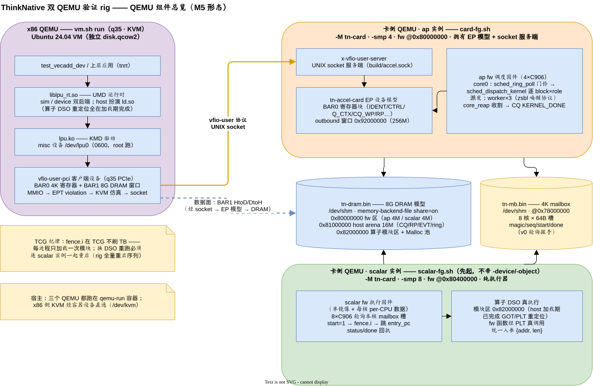
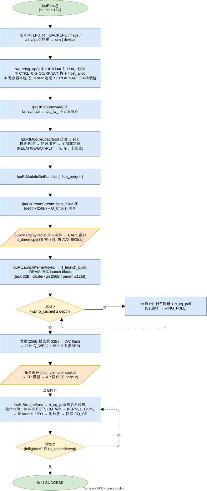
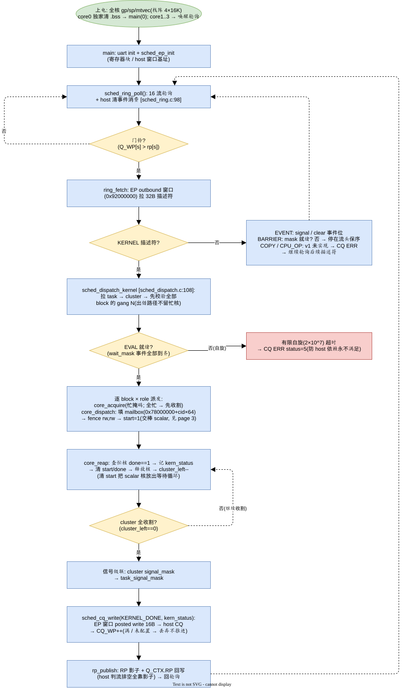
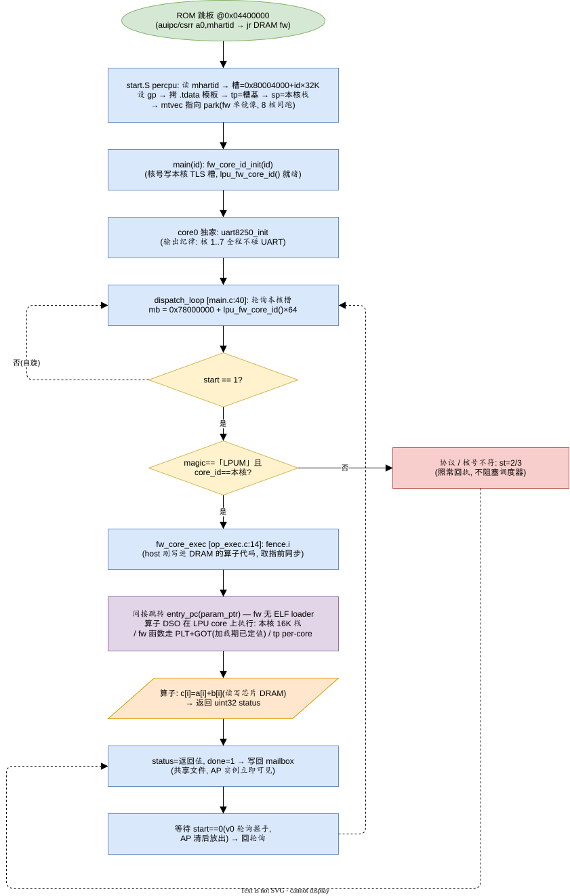
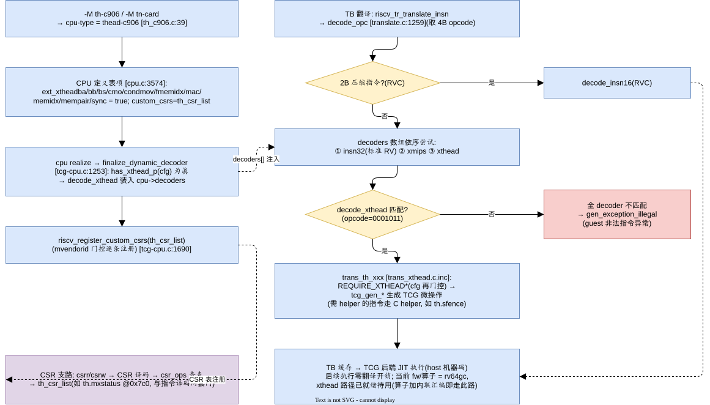

# LPU 软件实现：算子动态链接（方案 b）落地

> 跨会话工作基线：上下文不够时按此继续，勿重新推导。目标态与已对齐决策见
> [docs/rt/lpu-sw-stack.md](docs/rt/lpu-sw-stack.md) §4.6–§4.8。

> 本文来自 LPU 验证环境仓库（QEMU 树）的移植。文中引用的 LPU-SCHED-SPEC.md、X86-VM-OPSLOG.md、BUILD-ENV.md、hw/riscv/*、Testing/x86-hostvm/* 位于验证环境仓库，不在本仓库内。

## Context

2026-10-27 对齐的目标态：算子改玄铁 Linux 工具链（gcc 10.2）编 `-fPIC -shared`
DSO，可引用 scalar fw 导出函数（方案 b）；host 加载期解析全部重定位；fw 无
ELF loader。本计划把它落成代码，分两阶段：

- **Phase A**：host 加载器扩展（fw 导出表 + .dynsym + GOT/PLT 重定位）+
  sample_op 回归 -shared + QEMU 上真 DSO 真执行（prelink 管线）。
- **Phase B**：core_fw 单镜像 + 每核 per-CPU 数据（TLS local-exec + tp），
  使方案 b 在 8 核上结构正确。

## 完成状态（2026-10-28，两阶段均落地并验证）

- 验证: host ctest 3/3（api/vecadd/**prelink** 差分校验）全绿;
  `make -C src op-smoke` **3 PASS**（直调 / mailbox 协议路径 /
  预链接 DSO 真 PLT 执行——含 TLS 版 `lpu_fw_core_id` 经 PLT 调用）。
- 与计划的偏差（下文 newlib 相关描述按此修正，正文保留原计划不再逐条改）:

  1. **工具链统一（2026-10-28 用户共识）**: fw 与算子全用玄铁 Linux 工具链，
     newlib/elf 工具链弃用。fw 去掉 newlib 依赖: 新增 mini_libc（printf 子集/
     memset/memcpy/strlen，-ffreestanding），删 syscalls.c，链接
     `-nostdlib -nostartfiles -lgcc`。B3 的 newlib reent 议题随之消失，
     **fw 无堆**（heap/heap_brk 整个不存在，比计划的 B3 更彻底）。
  2. **tp 约定（B1 预言的"对不上就调"触发）**: objdump 实测本工具链
     （binutils 2.35/Xuantie）local-exec TPREL 偏移 = **TLS 块内偏移**
     （fw_this_core@块+0 → 0(tp)，uart8250_dev@块+8 → 8(tp)）→
     **tp = 槽基（TLS 块起点）**，不是 psABI 惯称的槽基+0x800。start.S:
     `mv tp, 槽基`。
  3. **percpu 启动路径必须先配 gp（实测翻车后补）**: ld 会把
     `__global_pointer$` 邻近符号装入放松成 gp 相对（实测 `_bss_end` →
     `addi t2,gp,-1920`），percpu 路径漏设 gp → .bss 清零上界 = 0−1920
     → 清零循环清穿 64MiB DRAM 后 store fault（`-d int` 定位 epc=0x4400054
     tval=RAM 尾）。已修: start.S percpu 路径先 `la gp, __global_pointer$`
     （norelax），并装 mtvec→park（对标 bootrom ap2sp 启动寄存器配置）。
  4. **vaddr→文件偏移换算**: DSO 的 PT_LOAD p_offset≠p_vaddr（LOAD2 偏移
     0xec0/虚址 0x1ec0），重定位 r_offset 是 vaddr，加载器经 PT_LOAD 换算
     （vaddr_to_off），比计划假设的"vaddr=文件偏移"更一般。
  5. **prelink 头语义**: base = m->base + min_vaddr（= LPU_OP_BASE 窗口起点），
     entry_off = e_entry − min_vaddr——与 min_vaddr 无关都成立。
  6. fw 导出符号 `lpu_fw_core_id` 地址 0x044000ca（2 对齐，JALR 可用;
     优化器布局变化会移动，prelink 每次对当前 fw ELF 重解析，无需固化）。

用户拍板的范围决定（2026-10-27）：

1. fw 单镜像**纳入**本计划（否则方案 b 算子 8 核执行不正确）。
2. **不写合成镜像/sim 侧最小化**：测试直接加载真产物；不扩展 test_image.h
   的 DSO/fw-ELF 构造器；sim 后端代码零改动（仅加 10 行调试 getter）。

### 分工认知（三层验证，2026-10-27 与用户对齐，勿在后续会话推翻）

| 层 | 验证什么 | 迭代成本 |
|---|---|---|
| host ctest（rt_prelink 自校验） | 加载器逻辑（ELF 解析/符号解析/槽值计算），改代码内环 + 全流程失败时的分层定位 | 秒级 |
| th-c906 单机冒烟（prelink 管线） | DSO 真执行（PLT 调 fw、Phase B 的 tp/per-CPU 初始化）——**此路不含 host 进程，加载器在它上面验不到** | 秒级（docker QEMU） |
| 双 QEMU 全流程（x86 VM 跑真 runtime+驱动 ← vfio-user → 卡侧机器跑 fw） | 端到端最终验证（驱动/PCIe/WC 冲刷/fw 派发/8 核），独立项目阶段，本计划不改变其门槛 | 分钟级，等环境 |

用户澄清（2026-10-27）：x86 VM 里跑的就是 runtime+驱动——"QEMU 验不到 host"仅指 th-c906 单机冒烟那条路。

## 完成状态 II（2026-10-29，AP 固件多核 + fw 目录拆分）

fw/core → **fw/scalar**（原 percpu 单镜像设计原样保留，start.S/link.ld 从
common 下放本地）、fw/sched → **fw/ap**（**新写多核启动，弃 per-CPU 方案**:
AP 4 核 cache 一致、不执行计算算子（COPY 数据搬运走 DMA 引擎，语义上是
数据搬运算子，但不经算子 DSO 装载路径）→ 不背"fw 单镜像 + 算子 GOT/PLT 单值"约束 →
无 TLS/tp/槽阵，仅每核独立栈 4×16K，核间通信 = 共享 .bss + fence 保序）。
common 收缩为 uart8250 + mini_libc（uart8250_dev 由 `__thread` 改共享全局:
AP 无 tp，TLS 访问会 fault; scalar 单实例同样成立）。

- **AP 启动**（start.S）: 全核 gp/sp/mtvec → core0 独家拷 .data/清 .bss →
  fence → 写释放门魔数 → main(0); 其他核轮询魔数 → fence → main(core_id) →
  ap_worker_loop。栈阵外核号越界 park。
- **worker 派发协议 v0**（ap_worker.c/.h，fw 内部不进 include/）: seq 序号
  握手（core0 填 func/arg → fence → seq+1 → 阻塞等 done_seq; worker 见 seq
  跳变 → fence → fn(arg) → status → fence → done_seq）。无清零相 → 无错过
  跳变卡死窗口。RVWMO 四处 fence（真芯片 4 核真跑，不赌 TCG 强序）。
- **机型**: th-c906 `max_cpus` 1→8（默认单核不变; AP 跑 `-smp 4`）。
- **踩坑（已修）**: ld 链接脚本里**段内**定义的常量符号（`__ap_stack_size
  = 16K` 写在 .stacks 段内）会被做成段相对符号——start.S `la` 取到 RAM 地址
  （0x80008948）而非 16K，sp = 槽基 + (id+1)×RAM 地址 → 越界 park、整片
  无输出。修法 = 顶层定义（scalar `__percpu_stride` 同款先例）。症状特征:
  4 核全静默 + objdump `la` 目标注释是 RAM 地址。
- **验证**: ctest 3/3（prelink 指向 fw/scalar 新路径）; op-smoke 3 PASS
  （scalar 回归）; ap-smoke 13 PASS 行 = 9 闭环 + 3 SMP 派发 + 总结（worker
  banner 启动期字符级交错、无法整行 grep——按计划接受，活性经派发 PASS
  间接断言）; 生产变体 ap_fw.bin -smp 4 冒烟正常（4 核 banner + 门铃轮询）。

### 完成状态 II 增补（worker 唤醒协议 v1，2026-10-29 用户 review 修订）

用户 review 后三点修订，**seq 序号握手协议整体废除**，改 zsbl 唤醒模型
（参照 `~/code/zsbl` arch/riscv/src/smp.c `wake_up_other_core` + vector.S
`secondary_core_poll`——用户前公司实现）:

1. **唤醒 = 一次普通函数调用，只是跑在另一个核上**: `ap_wake(core, fn, priv)`
   填 16B 唤醒槽（priv → fence → fn 最后写）**立即返回**; 是否等完成、怎么等
   由上层自管（fn 无返回值无 status 回收，结果经共享内存自定协议回传）。
   worker 轮询循环从 C（ap_worker_loop）移入 start.S 汇编（zsbl 式，不进
   main）: 见 `fn != NULL` → fence → `priv → a0 → jalr` → 返回后 fence →
   自清 fn → 回轮询。与 zsbl 差异: 栈 = 编译时全局数组（无 sp/stack_size
   参数）; magic/version 校验取消（槽即 mhartid 索引，worker 信任唤醒方）。
2. **worker 全程不碰 UART**: 不再调 uart8250_init（core0 已初始化），
   idle 静默; sp 活体证据改由任务回传（selftest SMP 段打印，三核 sp 各差
   0x4000 = 各在自己 16K 栈槽内）。
3. **printf 加 amoswap 自旋锁**（common/mini_libc.c，.aq 取/.rl 放）:
   v0 worker banner 字符级交错根治——v1 输出全程仅 core0 打印 + 锁保底，
   任务内 printf 亦可安全。uart8250_putc/puts 裸口不加锁（调试逃生口）。

验证: clean 重编（调试编译前必 clean 纪律）; ap-smoke 13 PASS 检查行 + 3 行
smp dispatch + PASS (0 fail)（fw/Makefile 零改动，打印格式保持）; op-smoke
3 PASS 回归（mini_libc 波及 scalar）; ctest 3/3; 生产变体 -smp 4 core0
banner + 门铃轮询、worker 全静默。

**增补: SMP hello 自测段**（同日，用户提出）——唤醒三核各自**读自己的
mhartid** 打印（打印文本与回传值都来自 worker 自读 mhartid，非 core0
告知; 回传 mhartid == 槽号即"跑对核"机器校验）。worker 侧 printf 首次
真跑：行序任意（并行唤醒）、整行不乱（自旋锁），Makefile 按
"smp hello from core" 计 3 行断言。ap-smoke 断言随增: 13→14 PASS 行
（+1 检查行）+ hello 3 行。派发段唤醒前先 `ap_idle` 等上一段任务真正
返回（done 标志在 fn 返回前置位，fn 自清有微小窗口，不等可能吃 -2）。

## 完成状态 III（2026-10-30 ~ 10-31，联调日志 + M5 双 QEMU E2E 首次闭环）

三层验证表（分工认知节）的第三层——双 QEMU 全流程——就此补齐，B6 的
"8 核并发运行验证"缺口关闭：VM 内 `test_vecadd_dev` **E2E PASS**（vecadd
逐元素数值正确）。全链 = VM runtime → lpu.ko → vfio-user-pci → EP 模型
（tn-accel-card）→ ap fw 调度 8 核 → mailbox → scalar fw 真核执行（真 DSO
真 PLT）→ CQ KERNEL_DONE → drain → DtoH 校验。过程中两大障碍（BAR0 被 8G
DRAM 遮蔽 / AVX-SIGILL）的完整定位实录在 X86-VM-OPSLOG.md（验证环境仓库）
§9，本节只记软件栈落地物与操作流程。

### 联调日志基建（runtime/fw 双方，可一键静音）

- **runtime 侧**：`rt_log_()`（rt_error.c，stderr，`[rt] ` 前缀）。env
  `LPU_RT_LOG=0` 关（默认开，首次读后缓存）。覆盖事件级：Init/bring_up
  （IDENT/CTRL/影子分配）、ModuleLoad/GetFunction、CreateStream/launch_build/
  submit/drain、RP advance、host_alloc、doorbell。
- **fw 侧**：`src/{ap,scalar}/common/fw_debug.h` 的 `DBG` 宏（默认展开 printf;
  `make NODEBUG=1` → `-DTN_FW_NODEBUG` → 展开为空）。纪律：事件级，轮询热
  循环禁用；**日志字符串全 ASCII**（终端乱码教训）。ap = 行自旋锁多核安全;
  scalar = 单打印核纪律（DBG 仅 core0 路径，`lpu_fw_core_id()==0` 门控）。
- **mini_libc printf 增长度修饰** l/ll/z（%u/%d/%x/%X/%s/%c/%%）。**%p
  不支持**——指针打 `(unsigned long long)(uintptr_t)` 转 `%08llx`。
- fw Makefile 无头依赖跟踪：改头文件必须 `make clean` 重编（曾致假绿）。

### 设备窗口窄访问（KVM 不能仿真对 MMIO 的 256-bit AVX，SIGILL 修复）

- **现象**：VM 里 bring_up 的 64B memset（RP 影子，BAR1 页）SIGILL;gdb
  定位 = `__memset_avx2_unaligned_erms` 的 `vmovdqu %ymm0,(%rdi)`。
- **机制**：guest 访问 guest-物理 MMIO → EPT violation → KVM（内核 5.15）
  x86 仿真器不能仿真 256-bit AVX store → 仿真失败注入 #UD。判别特征：
  ≥2KB memset 走 rep stosb 字节路径幸存、≤64B 走 ymm 路径死（大小不对称）;
  与 `-cpu max`/CPUID 无关（VM cpuinfo == host，AVX 到普通内存全正常）。
- **修复**：rt_internal.h 新增 `rt_dmemset/rt_dmemcpy/rt_dmemmove`——
  8B 步进 + volatile（防编译器把步进循环向量化）、字节处理头尾、DtoD
  dst>src 从尾向前。**全部设备窗口**（BAR0/BAR1，含 arena/host-coherent
  内存）上的 libc memset/memcpy/memmove 一律替换：rt_init.c（CQ/RP/EVT
  影子）、rt_stream.c（ring）、rt_ring.c（32B 描述符）、rt_launch.c
  （block/param/task/cluster）、rt_module.c（span+PT_LOAD）、rt_memcpy.c
  （API 层 4 处，**含 DtoH 读回**——AVX load 同样踩）。宿主局部结构体与
  backend_sim 普通 RAM 不受限。
- **纪律（后续新代码）**：写设备窗口禁用 libc 内存函数，一律 rt_dmem*。
  8B 也是性能最优步长（每个 8B store = 一次 EPT violation → QEMU →
  socket → 卡侧往返;大块搬运慢是已知代价，异步化等 COPY 描述符通路）。

### M5 E2E 操作流程（run_vm.sh 后台拉起三实例 + VM 命令）

全量重启序列（改了 hw/riscv/* 或 hw/remote/* 时）：

```bash
# 1. 重编卡侧 QEMU（qemu-dev 容器，一条命令）:
docker run --rm -u root -v "$PWD:/work/qemu" -w /work/qemu qemu-dev \
  bash -c 'ninja -C build qemu-system-riscv64'
# 2. 停三个实例（共享文件清零在下一步 up 里自动做）:
scripts/run_vm.sh down
# 3. 一条命令后台拉起三个 QEMU 实例（scripts/run_vm.sh），串口日志在 build/rig/logs/ 下:
scripts/run_vm.sh
# 4. VM 内（每次 VM 重启都要）: sudo insmod ~/tn-metal/src/driver/lpu.ko
```

runtime 源码更新（纯 runtime 改动时三个 QEMU 实例全程不动）：

```bash
# 宿主机同步:
rsync -a -e "ssh -o PasswordAuthentication=yes -o PubkeyAuthentication=no -p 2222" \
  --exclude build \
  src/runtime/lpu_rt/ chris@127.0.0.1:~/src/runtime/lpu_rt/
# VM 内:
cd ~/src/runtime/lpu_rt && cmake -B build && cmake --build build
sudo env LPU_TEST_FW_ELF=$HOME/scalar_fw.elf LPU_TEST_DSO=$HOME/sample_op.so \
  LPU_RT_RING_DEPTH=256 timeout 120 ./build/tests/test_vecadd_dev
```

静音：runtime 侧 `LPU_RT_LOG=0`;fw 侧 `make NODEBUG=1` + clean 重编。
PASS 证据三实例对齐（串口日志在 build/rig/logs/）：VM 侧 `VECADD E2E PASS` + `cq_poll type=1 status=0`;
ap 实例日志 doorbell → KERNEL desc → dispatch 8 核 → reap 全 0 → CQ write →
rp_publish;scalar 实例日志 `[core0] exec ... status 0`。

### 剩余方向（v1 保守语义边界，下一步候选）

- memcpy/memset 仍是同步窗口直拷（COPY 描述符通路：`LPU_COPY_H2D/D2H` +
  CQ COPY_DONE 编码已在 lpu_desc.h 以 ★ ASSUMED 预留）——大块搬运的
  性能与异步化等它。
- MSI-X 完成中断、多 task/异构 block、BAR1 mmap 性能。

## 组件与流程图解（2026-11-02）

图源两个 drawio 文件（与本文件同目录）：`LPU-RIG.drawio`（rig 组件总览，
单页）与 `LPU-FLOW.drawio`（四视角软件流程，四页）。SVG 由
rlespinasse/drawio-export 容器导出到 `export/`：

```bash
cd docs/rt && docker run --rm -v "$PWD":/data rlespinasse/drawio-export -f svg
```

改图后重导出 SVG、必要时更新本文图片引用，再 md2html 重建 HTML（须在
本目录跑，`export/` 相对路径才解析）。

### rig 组件总览（三个 QEMU + 两个共享模型）

{width=100%}

- **x86 QEMU**（`scripts/run_vm.sh`，q35 + KVM，Ubuntu 24.04 VM）：软件栈全链在
  guest——app（test_vecadd_dev / tnrt）→ `liblpu_rt.so`（UMD；sim/device
  双后端，host 扮演 ld.so，算子 DSO 重定位全在加载期完成）→ `lpu.ko`
  （misc 设备 /dev/lpu0）→ q35 PCIe 上的 `vfio-user-pci` 客户端设备
  （BAR0 4K 寄存器 + BAR1 8G DRAM 窗口）。控制面/数据面都过 UNIX socket：
  每条 guest MMIO = EPT violation → KVM 仿真 → 一条 socket 消息；设备窗口
  内存访问一律 8B 窄访问 `rt_dmem*`（AVX 纪律，见上文）。
- **卡侧 QEMU · ap 实例**（`scripts/run_vm.sh`，-smp 4，fw @0x80000000）：唯一
  拥有 tn-accel-card EP 设备模型 + `x-vfio-user-server`（UNIX socket 服务端，
  build/accel.sock）的实例；ap fw 调度固件 4×C906——core0 门铃 →
  sched_dispatch_kernel 逐 block×role 派发，worker×3（zsbl 唤醒协议），
  core_reap 收割 → CQ KERNEL_DONE。
- **卡侧 QEMU · scalar 实例**（`scripts/run_vm.sh`，先起，不带
  -device/-object，-smp 8，fw @0x80400000）：纯执行器。scalar fw 单镜像 +
  每核 per-CPU 数据；8 核轮询本核 mailbox 槽（start 触发，status/done
  回执），fence.i 后跳算子 entry_pc；算子 DSO 在模块区 0x82000000 真执行
  （加载期已完成 GOT/PLT 重定位，统一入参 {addr, len}）。
- **两个共享模型**（/dev/shm 文件，`memory-backend-file share=on`，ap 与
  scalar 两实例背靠同一份）：`tn-dram.bin` 8G DRAM——0x80000000 fw 区
  （ap 4M / scalar 4M）、0x81000000 host arena 16M（CQ/RP/EVT/ring）、
  0x82000000 算子模块区 + Malloc 池；`tn-mb.bin` 4K mailbox @0x78000000
  （8 核 × 64B 槽，v0 轮询握手）。
- 三个 QEMU 都跑在 qemu-run 容器；x86 侧 KVM 经容器设备直通（/dev/kvm）。

### 四视角软件流程图

{width=100%}

Host 侧 `lpuRt*` API 到门铃写入的完整路径：流/FIFO 管理、模块加载
（DSO 解析 + fw 导出表 + GOT/PLT 重定位）、描述符下发与 CQ 轮询。

{width=100%}

ap fw core0 主循环：门铃 → 经 EP outbound 窗口拉 host 描述符 → 逐
block×role 派发到 mailbox → worker 执行 → core_reap 收割 → CQ
KERNEL_DONE。

{width=100%}

scalar fw 每核：轮询本核 mailbox 槽 → fence.i → 跳 entry_pc 经 PLT 真调
算子 → status/done 回执。

{width=100%}

target/riscv 译码树接入扩展指令的路径（.decode 文件 + trans_*.c.inc +
decoder_table）——厂商交付 QEMU 后自定义指令照此挂。

四页逐节点讲解在 `LPU-FLOW.md`（`flow_doc_build.py` 从 `LPU-FLOW.md.in`
生成），本节收图作速览。

### E2E 测试 test_vecadd_dev

`src/runtime/lpu_rt/tests/test_vecadd_dev.c`——device 后端全链 E2E，M5
形态的验收用例。宿主无 /dev/lpu0 → exit(77)（ctest SKIP_RETURN_CODE 跳过），
只在 VM 里真跑。

**链路**（每步都有 CHECK 断言）：Init(DEVICE) → SetFirmwareElf（**必须
card 构建**——fw 导出符号地址要与 scalar 实例实际位置一致）→
ModuleLoadFile(sample_op.so) + GetFunction("op_entry") → lpuRtMalloc
**单块连续区** 3×8×u32（统一 ABI 布局 [a|b|c]，da/db/dc 为段内偏移，
断言落 pool 区 ≥0x82000000）→ HtoD a/b + `lpuRtMemset` c=0 →
CreateStream → LaunchKernelAsync("op_entry", {dbuf, 96}, 1 block × 8 核
SPMD) → StreamSync → DtoH → 逐元素校验 c[i]==a[i]+b[i] → Destroy/Free/
Shutdown。

**8 核 SPMD 即活性断言**：sample_op 每核只算 c[core_id] 一个元素，c 预
清零——回读全对 ⇔ 8 核全活且各写各的片（哪一核死了对应元素恒 0，立即
暴露）。

**VM 内部署**（VM 独立 qcow2 看不到宿主仓库 → scp 四件套：test 二进制 /
liblpu_rt.so.0.1.0 / scalar_fw.elf / sample_op.so）：

```bash
sudo insmod ~/tn-metal/src/driver/lpu.ko   # 每次 VM 重启后
cd ~/e2e && ln -sf liblpu_rt.so.0.1.0 liblpu_rt.so.0
sudo env LD_LIBRARY_PATH=$HOME/e2e LPU_TEST_FW_ELF=$HOME/e2e/scalar_fw.elf \
  LPU_TEST_DSO=$HOME/e2e/sample_op.so ./test_vecadd_dev
```

misc 设备默认 root:root 0600 必须 root 跑；sudo env_reset 丢
LD_LIBRARY_PATH 与自定义变量，须 `sudo env VAR=...` 显式带。换 DSO 重跑
必须连 scalar 实例一起重启（fence.i/TCG 纪律）。

**预期**：`== VECADD E2E PASS ==`，三实例日志对齐（build/rig/logs/）——VM 侧
`cq_poll type=1 status=0`；ap 实例日志 doorbell → KERNEL desc → dispatch
8 核 → reap 全 0 → CQ write → rp_publish；scalar 实例日志 `[core0] exec ...
status 0`（其余核回执走 mailbox done/status 字段不进串口——输出纪律）。
操作实录与坑：X86-VM-OPSLOG.md §9/§9.1。

## Phase A 改动清单

### A1. src/runtime/lpu_rt/src/rt_module.c — 加载器扩展（核心）

- **fw 导出表解析**（新函数，供 lpuRtSetFirmwareElf 调用）：解析 fw ELF 的
  section headers 走 SHT_SYMTAB，提取 **`lpu_fw_` 前缀** + STT_FUNC +
  STB_GLOBAL/WEAK 符号 → {name, 绝对地址（st_value 原样）} 缓存。校验
  ELF magic/ELF64/LE/EM_RISCV（**不要求 ET_DYN**——fw 是 ET_EXEC）。
  前缀过滤是策展式 API 面（fw 内部 `fw_*` 函数与 newlib 全局不被导出）。
- **模块加载路径**：
  - 新增 .dynsym 解析（节表 SHT_DYNSYM，sh_link → .dynstr）→ 逐条定值：
    defined（st_shndx != SHN_UNDEF）→ `m->base + st_value`; UND → fw 导出表
    按名查 → fw 绝对地址；查不到 → stderr 打印符号名 +
    `LPU_RT_ERROR_SYMBOL_NOT_FOUND`（弱 UND 同样拒绝，严格 ABI）。
  - 重定位从"只走 DT_RELA/DT_RELASZ"扩为**两个区**：`.rela.dyn`
    （DT_RELA/DT_RELASZ）+ `.rela.plt`（DT_JMPREL/DT_PLTRELSZ）。
    类型：RELATIVE → `base + r_addend`（现有）; R_RISCV_64（GOT/GLOB_DAT）
    与 R_RISCV_JUMP_SLOT → `符号定值 + r_addend`; 其余（含全部 TLS 类）→
    MODULE_INVALID（严格 ABI 保持）。
  - DT_NEEDED 出现 → MODULE_INVALID（禁 libc 依赖，明确报错）。
  - 失败路径沿用 invalid_free 模式。
- elf.h 兼容宏增补（老宿主 glibc 2.31）：R_RISCV_64=2、R_RISCV_JUMP_SLOT=5。

### A2. src/runtime/lpu_rt/include/lpu_rt.h + rt_error.c — 公开 API

```c
/* 注册固件 ELF（算子引用 fw 导出函数用）。须在 lpuRtInit 后、首次加载
 * 含 UND 符号的算子前调用；buffer 风格与 lpuRtModuleLoad 一致。 */
lpuRtError lpuRtSetFirmwareElf(const void *fw_elf_image, size_t size);
```

- 错误码枚举**末尾追加** `LPU_RT_ERROR_SYMBOL_NOT_FOUND`（现枚举止于
  `_NOT_READY`，追加不破坏既有值）; lpuRtGetErrorString 同步加映射。
- 更新 lpuRtModuleLoad 的头注释（现在只写 R_RISCV_RELATIVE）。

### A3. src/runtime/lpu_rt/src/rt_internal.h + rt_init.c

- `lpu_ctx_t` 增 fw 导出表字段（数组 + count，仿 funcs/nfuncs）;
  `lpuRtShutdown` 释放。

### A4. src/runtime/lpu_rt/include/lpu_rt_sim.h — 调试 getter

```c
lpuRtError lpuRtSimModuleBase(lpuRtModule module, uint64_t *dev_base);
```

- sim 后端返回 `m->base`; device 后端 UNSUPPORTED（同 lpuRtSimSetExecHook
  处理）。测试读回 DRAM 窗口校验槽值用（配合已有 lpuRtSimPtrToHost）。

### A5. include/lpu/lpu_fw_api.h — 新头文件（fw 对算子的 API 面）

- `#define LPU_FW_API_PREFIX "lpu_fw_"` + `uint32_t lpu_fw_core_id(void);`
  原型（仅函数、无数据——纪律）。
- 位置在共享 ABI 头目录（跨组件：core_fw 实现 / sample_op 调用 / rt_module.c
  取前缀）; runtime CMake 已 PRIVATE include `../include`。

### A6. core_fw — 最小导出（Phase A 形态）

- 新文件 fw/core/fw_api.c（或并入 op_exec.c）：实现 lpu_fw_core_id，Phase A
  返回编译期 core id（现状 FW_CORE_ID 占位 0; Phase B 升 __thread）。
- **保活**：lpu_fw_core_id 无 fw 内部引用，`--gc-sections` 会裁掉 →
  link 脚本 KEEP 或 selftest 显式调用一次（调用兼做保活 + 返回值校验）。
- dispatch_loop / fw_core_exec 不动。

### A7. src/scalar/sample_op — 构建切换

- 工具链：`~/Xuantie-900-gcc-linux-5.10.4-glibc-x86_64-V2.6.0/bin/
  riscv64-unknown-linux-gnu-`（gcc 10.2，已确认在位）。
- CFLAGS：`-march=rv64gc -mabi=lp64d -mcmodel=medany -O2 -g -fPIC
  -ffreestanding -fno-stack-protector -fno-builtin -Wall -Wextra`（与 fw
  一致——真芯片上算子与 fw 同 ABI 执行）。
- 链接：`-shared -nostdlib -nostartfiles -Wl,-Bsymbolic
  -Wl,--build-id=none -Wl,-e,op_entry`；输出 `sample_op.so`。
- **删除 ET_EXEC 头补丁 hack**（Makefile dd 补丁 + 校验行）。
- 源码：调用 `lpu_fw_core_id()`，结果参与返回值判断路径（防死码消除，不写
  全局——纪律）。零全局不变。

### A8. rt_prelink 工具兼 ctest — src/runtime/lpu_rt/tools/rt_prelink.c（host gcc，非交叉；**与测试合一，2026-10-27 合并 A8/A9**）

一个二进制两用：加载器逻辑的 host ctest（自校验）+ QEMU 冒烟的预链接镜像
产出工具。真产物路径（缺产物 → FAIL 并打印"先 make -C src"指引，
不静默跳过）：

- fw ELF：`src/scalar/build-selftest/scalar_fw_selftest.elf`（冒烟部署的就是
  selftest 镜像，符号地址须一致——fw ELF 副本与部署同 build 纪律）。
- DSO：`src/scalar/sample_op/sample_op.so`。

流程：

1. `lpuRtInit(LPU_RT_INIT_SIM)`；
2. **哑分配**把 DRAM 池推到约定基址 OP_BASE（`lpuRtMalloc` 一块
   [池基址, OP_BASE) 并持有）；
3. 负例×2: 坏 ELF 头（零字节串）→ MODULE_INVALID; 未注册 fw 时
   ModuleLoad(DSO) → SYMBOL_NOT_FOUND（失败释放池块，可重试）;
4. `lpuRtSetFirmwareElf` → `lpuRtModuleLoad(DSO)` →
   `lpuRtSimModuleBase`（校验 == OP_BASE）+ `lpuRtSimPtrToHost` 读回各
   重定位槽逐个断言（RELATIVE = base+addend; GOT/JUMP_SLOT(UND) = fw 符号
   地址）→ GetFunction("op_entry")/GetFunction(NULL) 断言入口一致;
5. 导出 [16B 头 {magic, base, entry_off, size} + 模块 span] →
   `sample_op.prelink.bin`（参数指定或默认构建树内路径）。

ctest 注册为 "prelink"（需真产物，依赖顺序文档写明 fw make 先行）。

约定：OP_BASE = fw RAM 空闲区固定地址（当前 1M 布局建议 0x80080000，避开
fw .data/stack/heap; Phase B 的 per-CPU 区注意避让，见 B1）。

### A10. fw selftest 增"真 DSO 直调"段 — fw/core/selftest.c（约 30 行）

- 检查 OP_BASE 头 magic（QEMU `-device loader,file=sample_op.prelink.bin,
  addr=<OP_BASE-16>` 装载; 不存在则跳过该段，保持冒烟自包含）；
- 组 param（复用现有 buf_a/b/c）→ 填 lpu_core_mb_t {entry_pc = 头.base +
  头.entry_off} → 走 fw_core_exec（复用其 fence.i）→ 校验 vecadd 结果 +
  lpu_fw_core_id 相关校验（op 返回 0 即 PLT 调用路径正确）。
- fw/Makefile 增目标：`op-smoke`（依赖 sample_op.so + fw selftest 构建 +
  build 的 rt_prelink 产物，组装 QEMU 命令）、`op-abi-check`
  （readelf 断言：sample_op.so 重定位类型 ⊆ {RELATIVE,64,JUMP_SLOT}、
  .symtab 在、无 DT_NEEDED）。

## Phase B 改动清单（core_fw 单镜像 + 每核 per-CPU 数据）

### B1. 链接脚本（fw/core/link_core.ld，从 common/link.ld 派生；sched 不动）

- 增 `.tdata`（模板放 ROM，LMA 同 .data 模式）/`.tbss (NOLOAD)`;
- `__percpu_base` / `__percpu_stride`（stride = align16K(tdata+tbss+栈 16K);
  堆保持共享 64K + 纪律注释"dispatch 路径禁 malloc"）；
- RISC-V TLS 约定：local-exec 首块位于 tp−0x800 → 导出
  `__tp_off`（= tdata 块起 + 0x800），**实现时以 objdump 反汇编
  lpu_fw_core_id 的访问序列验证**（tp 相对偏移对不上就调 __tp_off 定义）;
- `KEEP(.text.lpu_fw_core_id)`（A6 的保活落点）。

### B2. common/start.S — CONFIG_FW_CORE_PERCPU 启动段

读 core id（v1 占位 `li x, 0`，预留 FW_CORE_ID_REG 读法——决策 5 的 IC
专门功能，等卡侧机器）→ percpu_base = `__percpu_base + id×stride` → 拷
.tdata 模板到本核槽 → 清 .tbss → sp = 本核栈顶 → tp = percpu_base +
`__tp_off`。sched fw 不定义该 CONFIG → 走原路径。

### B3. 可写状态改造（core fw）

- `uart8250_dev`（.bss）与 `heap_brk`（.data）→ `__thread`；CFLAGS 增
  `-ftls-model=local-exec`。
- newlib reent/`_impure_ptr` 保持共享 + 纪律注释：**stdio/errno 仅限启动与
  自测冷路径**，dispatch_loop 不得调用（现况已满足）。
- dispatch_loop 的 mailbox 槽改 `FW_MB_BASE + lpu_fw_core_id()×64`
  （运行时 id，替换编译期 FW_CORE_ID 乘法）。
- selftest.c 的 static 缓冲不改（selftest 单核语义）。

### B4. lpu_fw_core_id 升级

返回 `__thread uint32_t fw_this_core`（启动时写入）。tp 相对访问 →
**拷贝无关性**：任意核执行都读自己 tp 槽——fw 单镜像（或即便多副本）下
8 核语义都正确，这是"fw 导函数不导数据"纪律的执行面。

### B5. core/configs/sim_c906.h

FW_CORE_ID 常量 → 运行时（保留常量仅作 selftest 期望值）; 增
FW_PERCPU_BASE/STRIDE 引用链接符号、OP_BASE 常量。

### B6. 验证边界（诚实声明，写进文档）

th-c906 单核 → 验证 per-CPU 初始化代码（tp/sp/模板拷贝）、DSO 执行;
**8 核并发正确性 = 结构性成立**，运行验证等卡侧机器（x-remote 派生 9-hart
+ per-hart core-id syscon）落地后补。sched fw 单实例，普通全局合法，不改。

## 明确不做（等 memorymap 定稿/独立排期，后续会话勿顺手带入）

- 占位改址（SCHED_HOST_WIN_BASE→0x40000000、SCHED_REG_BLOCK_BASE→
  0x50000000、MB_BASE→0x78000000）与 mailbox→sche_fifo 改名。
- sched fw task/cluster 解析直读芯片 DRAM 接线。
- fw ELF build-id 一致性校验与来源约定（随安装/env）——冒烟先靠"同一棵树
  构建 + 用 selftest ELF"纪律。
- 卡侧机器（9-hart）+ per-hart core-id 寄存器 + 设备后端 E2E。
  **已完成（2026-10-31，形态演进为 tn-card 机器：fw-load-addr 经 -bios 装载
  进共享 DRAM + resetvec 跳转 + 共享文件 DRAM/mailbox，无 9-hart syscon;
  M5 E2E 8 核真跑 PASS，见完成状态 III 与 scripts/run_vm.sh 文件头）**。
- sched fw per-CPU 化（单实例不需要）。

## 验证（如何算完成）

1. host：`cmake --build build && (cd build && ctest)`
   全绿（新增 prelink 测试 = 加载器自校验 + 产出镜像，用真产物; vecadd/api
   不回归）。
2. `rt_prelink` 产出 `sample_op.prelink.bin`（头校验 base==OP_BASE，ctest
   内已断言）。
3. `make -C src && make -C src op-abi-check` 通过。
4. docker QEMU 冒烟：`-M th-c906 -bios build-selftest/core_fw_selftest.bin
   -device loader,file=…/sample_op.prelink.bin,addr=<OP_BASE-16>` →
   selftest 3 项 PASS（直调/协议路径/**真 DSO + PLT 真执行**）。
5. Phase B 完成后重跑 3–4（含 objdump 验证 tp 相对访问序列）。
6. 文档：docs/rt/lpu-sw-stack.md §4.6/§4.7 目标态翻转为现状 + 固化差距清单更新 +
   §4.8 标注更新 + §6 状态表 + md2html 重建; 记忆同步。

## 关键事实速查（已核实，实现时直接引用）

- 工具链在位：Linux V2.6.0（gcc 10.2，prefix riscv64-unknown-linux-gnu-）、
  newlib 实为 **V3.2.0**（gcc 14.1.1，fw Makefile 已指向它）。
- fw 链接：common/link.ld，ROM 0x04400000/64K + RAM 0x80000000/1M；
  .data LMA ROM; .stack 16K/.heap 64K NOLOAD; CFLAGS rv64gc/lp64d/medany
  -ffunction-sections -fdata-sections -Wl,--gc-sections。
- core_fw 唯一 fw 逻辑导出 fw_core_exec; selftest 走 fw_core_exec 已含
  fence.i（op_exec.c:18）。lpu_core_mb_t 64B，magic "LPUM"。
- sample_op 现状：零重定位、零全局、单 PT_LOAD、entry op_entry、默认链接
  基 0x10000、dd 补丁 e_type@偏移16。
- test_vecadd 全合成镜像（test_image.h），不加载 sample_op——本计划不改它。
- lpu_ctx_t 无 fw 字段（全新增）; LPU_RT_API = visibility(default);
  错误枚举 0..16（_NOT_READY 止）。
- QEMU 只能 docker 跑（宿主缺 libfdt）; CJK 文本经 heredoc 写入会损坏——
  含中文的源文件一律用 Write 工具写。
